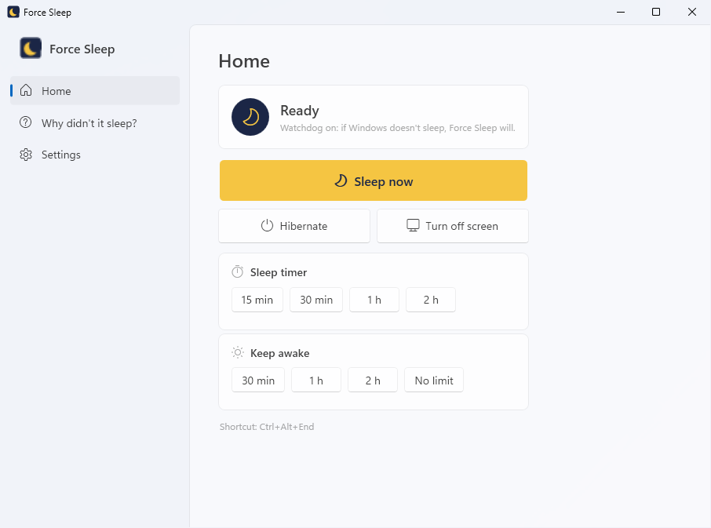
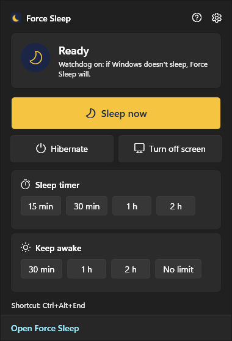
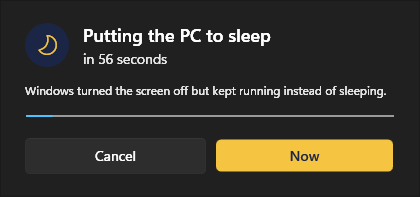
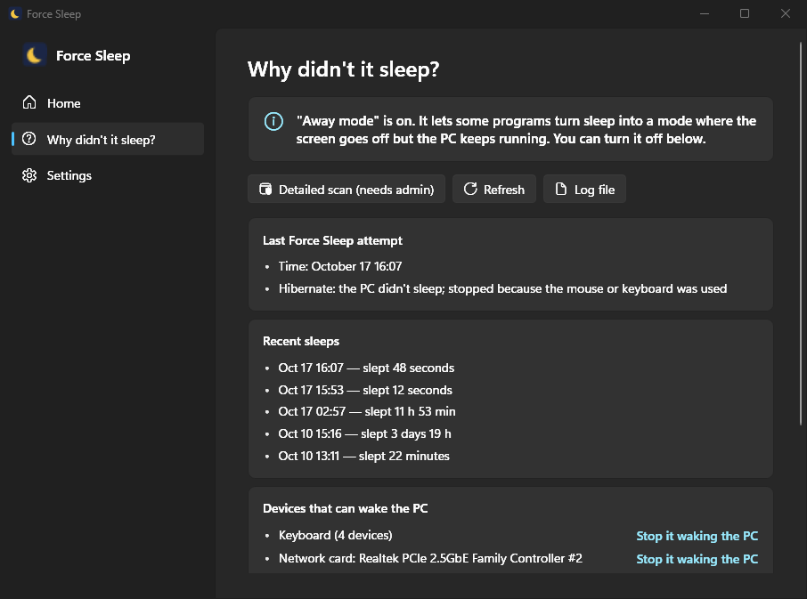
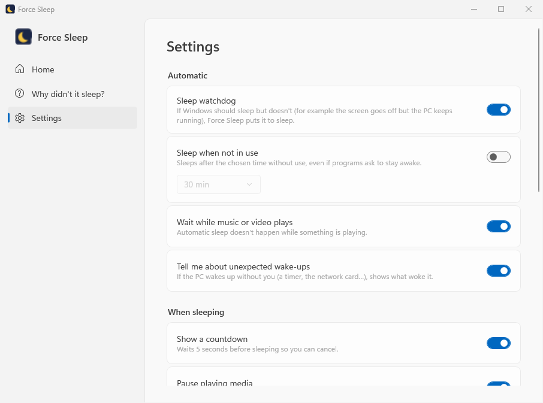

<p align="center"></p>

<h1 align="center">Force Sleep</h1>

<p align="center">
  <b>A small tray app that puts your Windows PC to sleep — for real.</b><br>
  If the screens go dark but the PC keeps running, it finds out why and fixes it.
</p>

<p align="center">
  <a href="https://github.com/niyazicokuysal/windows-force-sleep/releases/latest"></a>
  
  
  <a href="LICENSE"></a>
</p>

<p align="center">
  <a href="https://github.com/niyazicokuysal/windows-force-sleep/releases/latest"><b>⬇️ Download</b></a> ·
  <a href="#usage">Usage</a> ·
  <a href="#sleep-watchdog">Sleep watchdog</a> ·
  <a href="#why-didnt-it-sleep">Why didn't it sleep?</a> ·
  <a href="#faq">FAQ</a>
</p>

---

You click Sleep, the screens go dark, but the PC actually keeps running — and the moment you touch the mouse it's back as if nothing happened. If that sounds familiar, Force Sleep is for you.

<p align="center">
  
  &nbsp;
  
</p>

<table>
  <tr>
    <td width="50%" valign="top">
      <h3>🌙 One-click sleep</h3>
      Click the moon in the tray → <i>Sleep now</i>. Or press <kbd>Ctrl</kbd>+<kbd>Alt</kbd>+<kbd>End</kbd> from anywhere.
    </td>
    <td width="50%" valign="top">
      <h3>🛡️ Sleep watchdog</h3>
      If Windows should sleep but doesn't — screen off, PC still running — Force Sleep notices and puts it to sleep.
    </td>
  </tr>
  <tr>
    <td width="50%" valign="top">
      <h3>⏱️ Sleep timer &amp; keep awake</h3>
      "Sleep in 30 minutes", or the opposite: "don't sleep for 2 hours". One tap each.
    </td>
    <td width="50%" valign="top">
      <h3>✅ Did it really sleep?</h3>
      Force Sleep checks. If not, it escalates to forced sleep, then hibernate.
    </td>
  </tr>
  <tr>
    <td width="50%" valign="top">
      <h3>🔍 Why didn't it sleep?</h3>
      Shows what woke the PC or keeps it awake, in plain words — and fixes it in one click, with undo.
    </td>
    <td width="50%" valign="top">
      <h3>🎨 Modern and private</h3>
      Windows 11 style, light and dark theme, English and Turkish. Never connects to the internet.
    </td>
  </tr>
</table>

---

## Contents

- [Install](#install)
- [Usage](#usage)
- [Sleep watchdog](#sleep-watchdog)
- [Sleep or hibernate?](#sleep-or-hibernate)
- [Why didn't it sleep?](#why-didnt-it-sleep)
- [Settings](#settings)
- [How it works](#how-it-works)
- [FAQ](#faq)
- [Command line](#command-line)
- [Development](#development)
- [Roadmap](#roadmap)

---

## Install

Download `ForceSleep-Setup-<version>.exe` from the [latest release](https://github.com/niyazicokuysal/windows-force-sleep/releases/latest) and run it.

- No admin rights needed; installs for your user only.
- The installer asks for the language (English or Turkish) and whether to start with Windows.
- To uninstall: *Settings › Apps › Force Sleep › Uninstall*.

---

## Usage

Force Sleep lives in the **moon icon** next to the clock. If you don't see it, click the **^** arrow left of the clock; drag the icon onto the taskbar to keep it visible.

| Where | What opens |
|---|---|
| **Left-click** the moon | Quick panel: *Sleep now*, *Hibernate*, *Turn off screen*, sleep timer, keep awake |
| **Right-click** the moon | Short menu: Sleep now, Open, Why didn't it sleep?, Exit |
| Start menu › **Force Sleep** | Main window: Home, Why didn't it sleep?, Settings |
| <kbd>Ctrl</kbd>+<kbd>Alt</kbd>+<kbd>End</kbd> | Sleep from anywhere (changeable in Settings) |

**Before sleeping**, a 5-second countdown lets you *Cancel*, or go *Now*. Music and videos that are playing get paused.

<p align="center"></p>

- **Sleep timer:** sleeps after 15 min, 30 min, 1 h or 2 h — handy when falling asleep to a film or music. The time left shows in the panel.
- **Keep awake:** stops the PC from sleeping on its own for a while (or until you stop it), e.g. during a big download. The watchdog stays out of the way meanwhile.
- **Turn off screen:** turns the monitors off without sleeping.

---

## Sleep watchdog

The headline feature. It doesn't matter how the sleep started — Start › Sleep, the power button, or Windows' own timer.

| The watchdog notices | It does |
|---|---|
| Windows went into **away mode** instead of sleeping (screen off, PC running) | Sleeps after 30 seconds without input |
| Windows' *"sleep after"* time passed 2 minutes ago, the screen is off, the PC is still awake | Sleeps |

It's careful not to sleep at the wrong time. It waits:

- **While media plays** — music or video (optional).
- **While *keep awake* is on.**
- **For 5 minutes after a wake-up** — an update or timer may have woken the PC on purpose.
- **After an attempt that didn't work**, rather than retrying in a loop.
- **When Windows is set to never sleep** — that choice is respected.

**Sleep when not in use** (off by default) is your own idle timer, e.g. "sleep after 30 minutes without use". Unlike Windows' own, it ignores programs asking to stay awake.

**Unexpected wake-up notifications** tell you when the PC woke up without you — a timer, the network card — and what did it. Click the notification to open *Why didn't it sleep?*.

---

## Sleep or hibernate?

Both let you pick up where you left off. The difference is **where** your open work is kept:

- **Sleep** keeps everything in **RAM**, which needs a trickle of power.
- **Hibernate** writes everything to **disk** and powers off completely.

| | 💤 Sleep | 🧊 Hibernate |
|---|---|---|
| Wakes up | Very fast (1–3 s) | Slower (10–30 s) |
| Power use | Very little | None |
| If power is cut | Unsaved work is lost | Nothing is lost |
| Woken by | Mouse, keyboard, power button | Power button only |
| Wakes by itself | Can happen | Very rare |

Sleep for short breaks; hibernate when you'll be away for long or sleep just won't stick.

---

## Why didn't it sleep?

<p align="center"></p>

This page explains, in plain words:

- **The last Force Sleep attempt** and which step worked.
- **Recent sleeps** — how long they lasted and what woke the PC.
- **Devices allowed to wake the PC** — keyboards, mice, the network card.
- **Windows settings** — whether away mode and wake timers are on.

**Detailed scan** (asks for admin once) also lists programs and drivers keeping the PC awake, and wake timers.

### One-click fixes

| Link | What it does | Admin |
|---|---|---|
| **Turn off** (Away mode) | Programs can no longer turn sleep into "screen off but still running". | No |
| **Turn off** (Wake timers) | Programs can no longer wake the PC at a set time. | No |
| **Stop it waking the PC** (devices) | That device can no longer wake the PC. Asks first for keyboards and mice. | Yes |
| **Ignore** (programs) | Windows disregards that program's stay-awake request. | Yes |

Every change is listed under **Changes you made with Force Sleep** with an **Undo** link.

For admin tasks, Force Sleep starts a copy of itself elevated once, which only accepts an allow-list of `powercfg` commands and never goes through a shell — so a malicious device or program name can't smuggle in anything else.

---

## Settings

<p align="center"></p>

| Setting | Default |
|---|---|
| Sleep watchdog | On |
| Sleep when not in use (15 min – 2 h) | Off |
| Wait while music or video plays | On |
| Tell me about unexpected wake-ups | On |
| Show a countdown | On |
| Pause playing media | On |
| Hibernate if sleep fails | On |
| Keyboard shortcut | <kbd>Ctrl</kbd>+<kbd>Alt</kbd>+<kbd>End</kbd> |
| Theme | Same as Windows (or light / dark) |
| Language | Windows language (or English / Turkish) |
| Start with Windows | Chosen during setup |

---

## How it works

```
 Normal sleep ──(not asleep within 12 s)──▶ Forced sleep ──(still not)──▶ Hibernate
                                                                        (if enabled)
```

1. **Normal sleep** — the same as Start › Sleep.
2. **Forced sleep** — sleeps without first asking apps and drivers, so they can't veto it.
3. **Hibernate** — the last resort.

**Did it really sleep?** Windows has two clocks: one counts time spent asleep, the other doesn't. The difference is how long the PC slept. As a backup, Force Sleep reads the wake event Windows logs after every sleep and hibernate.

**How does the watchdog know?** Windows tells apps when the display turns on or off and when away mode starts or ends. Force Sleep listens for those, and every 10 seconds checks idle time and Windows' sleep setting.

**Modern Standby PCs** (some newer laptops) have no classic sleep. Force Sleep detects this and uses hibernate there.

---

## FAQ

**Windows says "Windows protected your PC".**
The installer isn't code-signed yet, so SmartScreen warns. Choose *More info → Run anyway*.

**I closed the window — is Force Sleep gone?**
No, it keeps running in the moon icon. To quit, right-click the moon → *Exit*, or *Settings › Quit Force Sleep*.

**The shortcut doesn't work.**
Another app may already use it; the Settings page says so. Click the box and press a different shortcut.

**The watchdog put the PC to sleep during a film.**
Video players usually keep the screen on, and the watchdog never acts while the screen is on. Some players don't report to Windows' media controls, so Force Sleep can't see them playing — use *Keep awake* for those.

**Does it need admin rights?**
Not to install or to sleep. Only *Detailed scan* and some fixes (stopping a device from waking the PC, ignoring a program's request) ask once.

**Is any data sent anywhere?**
No, Force Sleep never connects to the internet. Settings and the log stay on your PC:

- `%APPDATA%\ForceSleep\settings.json` — settings
- `%APPDATA%\ForceSleep\log.txt` — a log of attempts; attach it when reporting a problem.

**What happens to my fixes when I uninstall?**
They're Windows settings, so they stay. Use **Undo** before uninstalling if you want them reverted.

---

## Command line

| Command | What it does |
|---|---|
| `ForceSleep.exe` | Opens the app, or brings the running one's window to the front. |
| `ForceSleep.exe --why` / `--settings` | Opens straight to *Why didn't it sleep?* or *Settings*. |
| `ForceSleep.exe --sleep` | Sleeps once without opening a window — for shortcuts and scripts. |
| `ForceSleep.exe --diagnose` | Prints the *Why didn't it sleep?* report as text. |
| `ForceSleep.exe --status` | Prints the version, supported sleep states, Windows' sleep timeout and media state. |

---

## Development

Requires the [.NET 10 SDK](https://dotnet.microsoft.com/download) on Windows 10 or 11, and [Inno Setup 6](https://jrsoftware.org/isinfo.php) for the installer (`winget install JRSoftware.InnoSetup`).

```powershell
dotnet build
dotnet test
./build.ps1                                # tests → exe → installer → winget manifests, in dist/
./build.ps1 -CertificateThumbprint <...>   # the same, signed with signtool
```

Debug builds accept `--light`, `--dark`, `--english`, `--panel` (opens the tray panel) and `--countdown` (shows the countdown without sleeping) for working on the UI.

### Project layout

```
src/ForceSleep/
  AppController.cs      The app's brain: sleeping, timer, keep awake, watchdog, hotkey, notifications
  SleepPolicy.cs        Watchdog and idle-sleep rules (a pure function, unit tested)
  SleepController.cs    Normal → forced → hibernate escalation and verification
  SystemEvents.cs       Display on/off, away mode, resume and hotkey events
  KeepAwake.cs          Keeping the PC awake
  MediaControl.cs       Detecting and pausing media through Windows' media controls
  Hotkey.cs             The global keyboard shortcut
  Strings.cs            All UI text, Turkish and English side by side
  DiagnosticsReport.cs  The "Why didn't it sleep?" report
  Fixes.cs              One-click fixes and undo
  PowerCfg.cs, PowerSettings.cs, SleepHistory.cs, AttemptHistory.cs, …
  Ui/                   WPF UI with the Fluent theme: main window, tray panel, countdown, pages
tests/ForceSleep.Tests/ Watchdog, hotkey, parser, report and language tests
installer/              Inno Setup script
winget/                 winget manifest templates
```

When adding UI text, add both languages to `Strings.cs` — a test fails if a text is left untranslated.

**Releasing:** bump `<Version>` in `ForceSleep.csproj`, run `./build.ps1`, and attach `dist/ForceSleep-Setup-<version>.exe` to a GitHub release tagged `v<version>`.

---

## Roadmap

- [x] **1.0** — Verified forced sleep, *Why didn't it sleep?*, one-click fixes, installer, English and Turkish
- [x] **2.0** — New Windows 11 style UI with dark theme, sleep watchdog, sleep timer, keep awake, keyboard shortcut, countdown, media pausing, unexpected wake-up notifications
- [ ] Code-signed releases
- [ ] winget package
- [ ] Sleep history statistics

### Known limitations

- **Forced sleep** and the **away-mode watchdog** haven't yet been exercised on a machine where sleep is actually being blocked; their rules are covered by unit tests.
- **Fixes that need admin** are covered by unit tests only so far.
- **Away mode and wake timers** are turned off in the active power plan only.
- **The exe is about 78 MB**, since it carries .NET and the UI libraries with it.

---

## License

[MIT](LICENSE) © 2026 Niyazi Berkay Çokuysal
