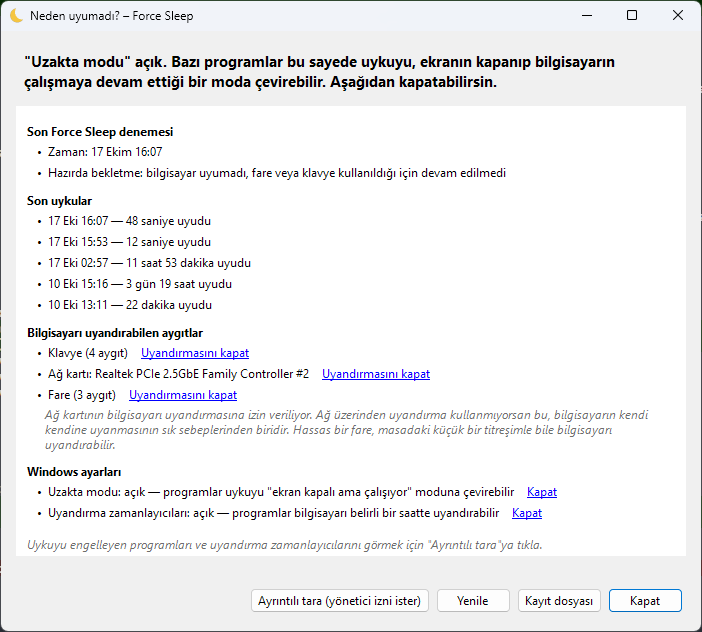

<p align="center"></p>

<h1 align="center">Force Sleep</h1>

<p align="center">
  <b>Windows bilgisayarını gerçekten uyutan küçük bir tepsi uygulaması.</b><br>
  Ekranlar kararıp bilgisayar çalışmaya devam ediyorsa, nedenini bulur ve düzeltir.
</p>

<p align="center">
  <a href="https://github.com/niyazicokuysal/windows-force-sleep/releases/latest"></a>
  
  
  
</p>

<p align="center">
  <a href="https://github.com/niyazicokuysal/windows-force-sleep/releases/latest"><b>⬇️ İndir</b></a> ·
  <a href="#kullanım">Kullanım</a> ·
  <a href="#neden-uyumadı">Neden uyumadı?</a> ·
  <a href="#sık-sorulan-sorular">SSS</a> ·
  <a href="README.en.md">English</a>
</p>

---

Uyku'ya basıyorsun, ekranlar kararıyor ama bilgisayar aslında çalışmaya devam ediyor. Fareye dokunduğun anda da hiçbir şey olmamış gibi açılıyor. Bu tanıdık geliyorsa Force Sleep tam bunun için.

<table>
  <tr>
    <td width="50%" valign="top">
      <h3>🌙 Tek tıkla uyku</h3>
      Saatin yanındaki ay simgesi → <i>Şimdi uyut</i>. Hepsi bu.
    </td>
    <td width="50%" valign="top">
      <h3>✅ Gerçekten uyudu mu?</h3>
      Bilgisayarın gerçekten uyuyup uyumadığını kontrol eder. Uyumadıysa zorla uykuya, o da olmazsa hazırda bekletmeye geçer.
    </td>
  </tr>
  <tr>
    <td width="50%" valign="top">
      <h3>🔍 Neden uyumadı?</h3>
      Bilgisayarı neyin uyandırdığını ve neyin uyanık tuttuğunu teknik terimler kullanmadan gösterir.
    </td>
    <td width="50%" valign="top">
      <h3>🛠️ Tek tıkla düzeltme</h3>
      Uzakta modu, uyandırma zamanlayıcıları, aygıtlar, programlar… Her değişiklik <i>Geri al</i> ile geri alınabilir.
    </td>
  </tr>
  <tr>
    <td width="50%" valign="top">
      <h3>🔒 Gizli ve hafif</h3>
      Kurulum için yönetici izni istemez, internete hiç bağlanmaz, verilerin bilgisayarından çıkmaz.
    </td>
    <td width="50%" valign="top">
      <h3>🌐 Türkçe ve English</h3>
      Windows'un dilini otomatik seçer, menüden istediğin zaman değiştirebilirsin.
    </td>
  </tr>
</table>

<p align="center"></p>

---

## İçindekiler

- [Kurulum](#kurulum)
- [Kullanım](#kullanım)
- [Şimdi uyut mu, hazırda beklet mi?](#şimdi-uyut-mu-hazırda-beklet-mi)
- [Neden uyumadı?](#neden-uyumadı)
- [Nasıl çalışır?](#nasıl-çalışır)
- [Sık sorulan sorular](#sık-sorulan-sorular)
- [Komut satırı](#komut-satırı)
- [Geliştirme](#geliştirme)
- [Sürüm yayınlama](#sürüm-yayınlama)
- [Yol haritası](#yol-haritası)

---

## Kurulum

**Kurulum dosyasıyla:** [Releases](https://github.com/niyazicokuysal/windows-force-sleep/releases) sayfasından `ForceSleep-Setup-<sürüm>.exe` dosyasını indir ve çalıştır. Kurulum yönetici izni istemez. Sihirbazda dili seçebilir ve uygulamanın Windows ile birlikte başlayıp başlamayacağını belirleyebilirsin.

**winget ile** (winget kataloğuna eklendikten sonra):

```powershell
winget install NiyaziBerkayCokuysal.ForceSleep
```

Kaldırmak için: *Ayarlar › Uygulamalar › Force Sleep › Kaldır* ya da `winget uninstall NiyaziBerkayCokuysal.ForceSleep`.

---

## Kullanım

1. Force Sleep'i Başlat menüsünden aç. *"Çalışıyor"* bildirimi gelir.
2. Saatin yanında sarı bir **ay simgesi** belirir.
   Görmüyorsan saatin solundaki **^** okuna tıkla. Simgeyi görev çubuğuna sürüklersen hep görünür kalır.
3. Simgeye tıkla ve **Şimdi uyut**'u seç.

### Menü

| Seçenek | Ne yapar |
|---|---|
| **Şimdi uyut** | Bilgisayarı uyutur. Uyumazsa daha güçlü yöntemleri sırayla dener. |
| **Hazırda beklet** | Bilgisayarı doğrudan hazırda bekletir. |
| **Neden uyumadı?** | Uyku sorunlarının sebebini gösteren ve düzelten pencereyi açar. |
| **Uyumazsa hazırda beklet** | Uyku hiçbir şekilde tutmazsa bilgisayarı açık bırakmak yerine hazırda bekletir. *(Varsayılan: açık)* |
| **Windows açılınca başlat** | Force Sleep oturum açınca sessizce başlar. |
| **Dil / Language** | Türkçe, English ya da Windows'un diline göre otomatik. |
| **Çıkış** | Uygulamayı kapatır. |

Bir şey yolunda gitmezse bir bildirim gelir. Örneğin uyku engellenip zorla uyutulduysa ya da bilgisayar birkaç saniye içinde uyandıysa. Bildirime tıklarsan ayrıntıları gösteren pencere açılır.

---

## Şimdi uyut mu, hazırda beklet mi?

İkisi de bilgisayarı kapatıp kaldığın yerden devam etmeni sağlar. Fark, açık olan her şeyin **nerede saklandığında**:

- **Uyku:** Her şey **RAM'de** kalır. RAM bilgiyi tutmak için elektrik ister, bu yüzden bilgisayar çok az da olsa güç çekmeye devam eder.
- **Hazırda bekletme:** Her şey **diske** yazılır ve bilgisayar tamamen kapanır.

| | 💤 Şimdi uyut | 🧊 Hazırda beklet |
|---|---|---|
| Uyanma hızı | Çok hızlı (1–3 sn) | Daha yavaş (10–30 sn) |
| Elektrik tüketimi | Çok az | Yok |
| Elektrik kesilirse | Kaydedilmemiş iş gider | Hiçbir şey kaybolmaz |
| Nasıl uyanır | Fare, klavye, güç düğmesi | Sadece güç düğmesi |
| Kendi kendine uyanma | Olabilir | Çok nadir |

**Hangisini seçmeli?** Kısa molalarda, örneğin gece ya da birkaç saat için, **Şimdi uyut** daha pratik. Uzun süre kullanmayacaksan ya da uyku bir türlü tutmuyorsa **Hazırda beklet** daha güvenli.

---

## Neden uyumadı?

Bu pencere şunları sade bir dille gösterir:

- **Son Force Sleep denemesi:** Hangi adımın işe yaradığını gösterir.
- **Son uykular:** Ne kadar sürdüklerini ve bilgisayarı neyin uyandırdığını gösterir. Bu bir fare, ağ kartı ya da Windows Update'in kurduğu bir zamanlayıcı olabilir.
- **Bilgisayarı uyandırabilen aygıtlar:** Uyandırma izni olan klavye, fare ve ağ kartlarını listeler.
- **Windows ayarları:** Uzakta modunun ve uyandırma zamanlayıcılarının açık olup olmadığını gösterir.

**Ayrıntılı tara** (bir kez yönetici izni ister) ayrıca şunları gösterir:

- **Uyanık kalmak isteyen programlar ve sürücüler:** Örneğin video oynatan bir tarayıcı sekmesi ya da kullanımdaki bir ses sürücüsü.
- **Uyandırma zamanlayıcıları:** Bilgisayarı ileride uyandırmak için kurulmuş görevler.

### Tek tıkla düzeltme

Sorunlu satırların yanında bir bağlantı çıkar:

| Bağlantı | Ne yapar | Yönetici izni |
|---|---|---|
| **Kapat** (Uzakta modu) | Programlar uykuyu "ekran kapalı ama çalışıyor" moduna çeviremez. *"Ekran kapanıyor ama bilgisayar çalışıyor" sorununun tipik sebebi budur.* | Hayır |
| **Kapat** (Uyandırma zamanlayıcıları) | Programlar bilgisayarı belirli bir saatte uyandıramaz. | Hayır |
| **Uyandırmasını kapat** (aygıtlar) | O aygıt (örneğin ağ kartı) artık bilgisayarı uyandıramaz. Klavye ve fare için önce onay sorulur. | Evet |
| **Yok say** (programlar) | Windows o programın uyanık kalma isteğini artık dikkate almaz. | Evet |

Yapılan her değişiklik **Force Sleep ile yaptığın değişiklikler** bölümünde listelenir ve **Geri al** ile eski haline döner.

Yönetici izni gereken işlerde Force Sleep kendini bir kereliğine yönetici olarak başlatır ve sadece şu komutları çalıştırır: aygıt uyandırmayı açma/kapama ve istek yok sayma. Komutlar bir kabuktan (cmd) geçmez. Böylece kötü niyetli bir program, adına özel karakterler koyarak yönetici yetkisiyle başka bir şey çalıştıramaz.

---

## Nasıl çalışır?

*Şimdi uyut*'a bastığında Force Sleep sırayla şu adımları dener:

```
 Normal uyku ──(12 sn içinde uyumadı)──▶ Zorla uyku ──(uyumadı)──▶ Hazırda bekletme
                                                                  (ayar açıksa)
```

1. **Normal uyku:** Başlat › Uyku ile aynı şeyi yapar.
2. **Zorla uyku:** Uygulamalara ve sürücülere "uyuyabilir miyim?" diye sorulmadan uykuya geçilir. Böylece itiraz edip uykuyu engelleyemezler.
3. **Hazırda bekletme:** Son çare olarak devreye girer.

**"Gerçekten uyudu mu?" nasıl anlaşılıyor?** Windows'ta iki saat var: biri uykuda geçen süreyi sayar, diğeri saymaz. Aradaki fark, bilgisayarın ne kadar uyuduğunu verir. Bu yeterli olmazsa Windows'un her uyanmadan sonra olay günlüğüne yazdığı kayda da bakılır.

**Fareye dokunursan ne olur?** Adımlar sürerken fare veya klavye kullanılırsa Force Sleep bir sonraki, daha sert adıma geçmez. Muhtemelen bilgisayarın başına döndüğünü varsayar.

**Modern Standby bilgisayarlar:** Bazı yeni laptoplarda klasik uyku hiç yoktur. Bu bilgisayarlardaki "uyku", ekranın kapalı olduğu ama sistemin çalışmaya devam ettiği bir moddur. Force Sleep bunu otomatik algılar ve bu bilgisayarlarda hazırda bekletmeyi kullanır.

---

## Sık sorulan sorular

**"Windows bilgisayarınızı korudu" uyarısı çıkıyor.**
Kurulum dosyası henüz dijital olarak imzalanmadığı için SmartScreen bu uyarıyı gösteriyor. *Ek bilgi* → *Yine de çalıştır* ile devam edebilirsin.

**Yönetici izni gerekiyor mu?**
Kurmak ve uyutmak için hayır. *Neden uyumadı?* penceresindeki **Ayrıntılı tara** düğmesi ile bazı düzeltmeler (aygıt uyandırmayı kapatma, program isteğini yok sayma) her seferinde bir kez izin ister.

**Verilerim bir yere gönderiliyor mu?**
Hayır, uygulama internete hiç bağlanmaz. Ayarlar ve kayıtlar sadece senin bilgisayarında durur:

- `%APPDATA%\ForceSleep\settings.json`: ayarlar
- `%APPDATA%\ForceSleep\log.txt`: denemelerin kaydı. Bir sorun bildirirken bu dosyayı eklemek çok yardımcı olur.

**Uygulamayı kaldırınca yaptığım değişiklikler ne olur?**
*Neden uyumadı?* penceresinden yaptığın değişiklikler (uzakta modu, aygıtlar vb.) Windows ayarlarıdır. Uygulama kaldırılsa da bu ayarlar kalır. Geri almak istiyorsan kaldırmadan önce **Geri al**'a bas.

**Uygulama Windows'un dilinde değil.**
Menüden **Dil / Language**'ı seç.

---

## Komut satırı

| Komut | Ne yapar |
|---|---|
| `ForceSleep.exe --sleep` | Tepsi simgesi olmadan bir kez uyutur. Masaüstü kısayolu veya script için uygundur. |
| `ForceSleep.exe --why` | Sadece *Neden uyumadı?* penceresini açar. |
| `ForceSleep.exe --diagnose` | Aynı raporu metin olarak yazdırır. |
| `ForceSleep.exe --status` | Sürümü ve bilgisayarın desteklediği uyku türlerini yazdırır. |

---

## Geliştirme

Gerekenler: [.NET 10 SDK](https://dotnet.microsoft.com/download), Windows 10 veya 11. Kurulum dosyası için ayrıca [Inno Setup 6](https://jrsoftware.org/isinfo.php) (`winget install JRSoftware.InnoSetup`).

```powershell
dotnet build              # derle
dotnet test               # testleri çalıştır
./build.ps1 -License MIT  # sürüm üret: test → exe → kurulum dosyası → winget dosyaları
```

### Proje yapısı

```
src/ForceSleep/
  TrayApp.cs            Tepsi simgesi, menü ve bildirimler
  Strings.cs            Tüm arayüz metinleri, Türkçe ve İngilizce yan yana
  SleepController.cs    Normal → zorla → hazırda bekletme sırası ve doğrulama
  SleepClock.cs         "Gerçekten uyudu mu?" saati
  DiagnosticsForm.cs    "Neden uyumadı?" penceresi
  DiagnosticsReport.cs  Toplanan bilgiyi sade bir dile çeviren rapor
  Fixes.cs              Tek tıkla düzeltmeler ve geri alma
  PowerSettings.cs      Güç planı ayarları (uzakta modu, uyandırma zamanlayıcıları)
  PowerCfg.cs           powercfg çıktısını ayrıştırma ve yönetici olarak komut çalıştırma
  SleepHistory.cs       Olay günlüğünden geçmiş uykular
  AttemptHistory.cs     Force Sleep'in kendi denemeleri (log'dan)
  PowerCapabilities.cs  Bilgisayarın desteklediği uyku türleri
  Native.cs             Windows API çağrıları
tests/ForceSleep.Tests/ Ayrıştırıcı, rapor ve dil testleri
installer/              Inno Setup kurulum script'i
winget/                 winget dosya şablonları
assets/                 Simge (tools/make-icon.ps1 ile üretilir)
```

**Yeni bir metin eklerken** `Strings.cs`'e hem Türkçesini hem İngilizcesini yaz. Bir metin iki dilde aynı kalırsa test başarısız olur.

---

## Sürüm yayınlama

1. `src/ForceSleep/ForceSleep.csproj` içindeki `<Version>`'ı artır.
2. `./build.ps1 -License <lisans>` çalıştır. Çıktılar `dist/` klasörüne yazılır.
3. GitHub'da `v<sürüm>` etiketiyle bir release oluştur ve `dist/ForceSleep-Setup-<sürüm>.exe` dosyasını ekle.
4. `dist/winget/manifests/...` klasörünü [microsoft/winget-pkgs](https://github.com/microsoft/winget-pkgs)'e pull request olarak gönder. Bunun için [`wingetcreate`](https://github.com/microsoft/winget-create) de kullanılabilir.

**İmzalama:** Bir kod imzalama sertifikan varsa `./build.ps1 -CertificateThumbprint <parmak izi>` ile exe, kurulum dosyası ve kaldırıcı imzalanır. Bunun için Windows SDK'daki `signtool.exe` gerekir. İmzalanmış dosyalarda SmartScreen uyarısı çıkmaz, ya da itibar kazandıkça kaybolur.

---

## Yol haritası

- [x] **v0.1:** Tepsi uygulaması, doğrulamalı zorla uyku, hazırda bekletme yedeği
- [x] **v0.2:** *Neden uyumadı?* penceresi
- [x] **v0.3:** Engelleri tek tıkla kapatma ve geri alma
- [x] **v1.0:** Kurulum dosyası, kendi simgesi, winget dosyaları, İngilizce dil desteği, imzalama altyapısı
- [ ] İmzalı ilk sürüm ve winget kataloğuna ekleme
- [ ] Microsoft Store (MSIX paketi)

### Bilinen sınırlamalar

- **Zorla uyku adımı** henüz uykunun gerçekten engellendiği bir durumda denenmedi. Windows bu adımı normal kullanıcı yetkisiyle reddederse bu, log dosyasına yazılır ve hazırda bekletmeye geçilir.
- **Yönetici izni gereken düzeltmeler** (aygıt uyandırma, program isteğini yok sayma) şimdilik sadece otomatik testlerle doğrulandı.
- **Uzakta modu ve uyandırma zamanlayıcıları** sadece etkin güç planında kapatılır. Başka bir güç planına geçersen orada tekrar kapatman gerekir.
- **Exe boyutu** yaklaşık 50 MB, çünkü .NET'i içinde taşıyor. Kurulum dosyası sıkıştırılmış haliyle daha küçük.
